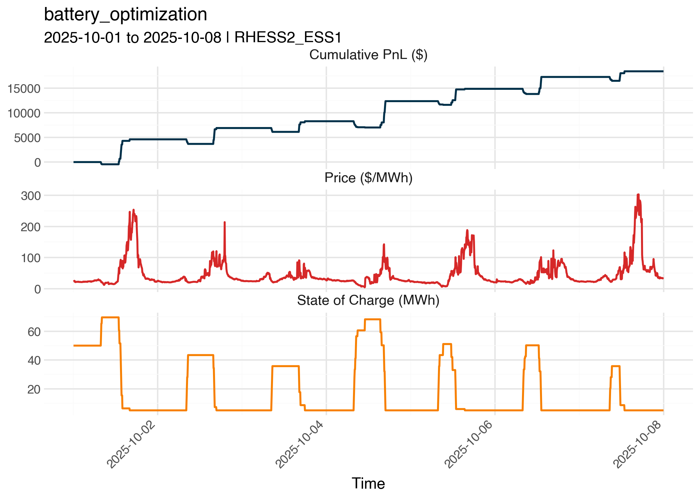

## Overview

This project implements an optimization strategy for a battery system participating in the 5-minute real-time (RT) market in [ERCOT](https://www.ercot.com/) based on [pre-RTC+B](https://www.tyba.ai/resources/guides/guide-to-ercot-rtcb/) (December 5, 2025) policies. The system makes buy/sell/hold decisions based on price forecasts while respecting battery constraints and tracking profitability.

📖 **Documentation:** [Architecture](docs/ARCHITECTURE.md) | [Optimization](docs/OPTIMIZATION.md)

## Installation

[Install `uv`](https://docs.astral.sh/uv/getting-started/installation/) if you don't already have it

```bash
# macOS/Linux
curl -LsSf https://astral.sh/uv/install.sh | sh

# Windows
powershell -ExecutionPolicy ByPass -c "irm https://astral.sh/uv/install.ps1 | iex"
```

Then install project dependencies:

```bash
uv sync
uv pip install -e .
```

## Usage

The `esrpy` package is designed to be used in notebooks or scripts:

```python
from esrpy import (
    load_lmps,
    run_backtest,
    BacktestConfig,
    BatteryConfig,
    ConfigurableOptimizationStrategy,
    PointInTimeData,
)

forecast_lmps, actual_lmps = load_lmps(
    actual_csv_path="path/to/actual_lmps.csv",
    indicative_csv_path="path/to/forecast_lmps.csv",
)

pit_data = PointInTimeData(forecast_lmps, actual_lmps)

results = run_backtest(
    pit_data,
    strategy=ConfigurableOptimizationStrategy(),
    backtest_config=BacktestConfig(),
    battery_config=BatteryConfig()
)
```

See [`notebooks/run_backtest.ipynb`](notebooks/run_backtest.ipynb) for a more detailed example, where one can create plots like this.




## Tests

```bash
uv run pytest tests/
```

## Linting

```bash
ruff format .
ruff check .
```
